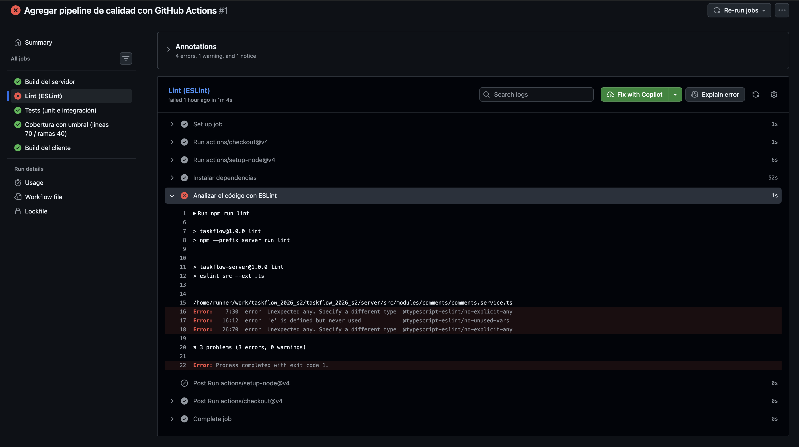

# Ejercicio 1A — Pipeline ejecutado en el repositorio

El workflow `.github/workflows/ci.yml` se ejecutó en GitHub Actions tras el push del commit `4766d75b79d01d486a9deed46d4c16c981ed20d2` a `main`, el 10 de noviembre de 2026. Esta ejecución confirma que Actions está habilitado y que el pipeline funciona en el repositorio.

[Ver ejecución CI de calidad (informativo) #1](https://github.com/AgustinMunizF/taskflow_2026_s2/actions/runs/42909893348).

## Evidencia del resultado

| Etapa | Resultado |
|---|---|
| Build del servidor | Correcto |
| Lint (ESLint) | Fallido: dos usos de `any` y una variable sin usar |
| Tests (unit e integración) | Correcto |
| Cobertura con umbral (líneas 70 / ramas 40) | Correcto |
| Build del cliente | Correcto |

El resultado global es rojo por lint. La consigna admite un pipeline verde o rojo; no exige corregir los fallos. La clasificación y las líneas del log se encuentran en [el entregable 1B](clase12-ejercicio1b-pipeline.md).

## Rama de entrega

La instalación inicial del workflow se publicó directamente en `main`, por lo que esa parte del procedimiento no se realizó mediante una rama y un PR. Los entregables posteriores se prepararon en `entregables-clase12`, incluyendo el job E2E del ejercicio 1C. La captura corresponde a la ejecución inicial, anterior a ese job; no demuestra su resultado ni la ejecución de un PR.
